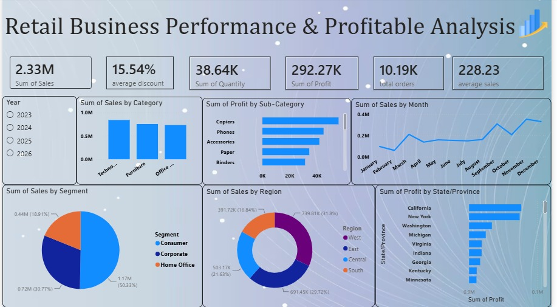
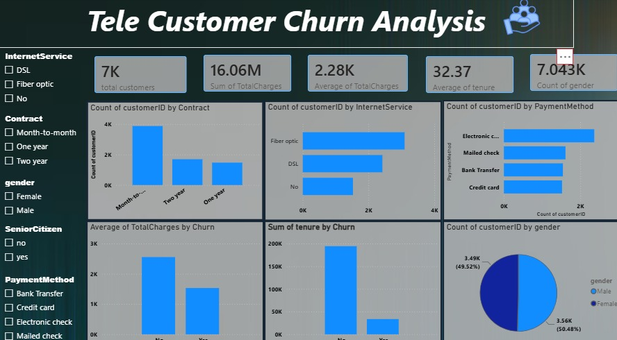

# Data Analyst Mini Projects — Power BI

Two end-to-end mini Power BI projects by **harshavardhaneaswar1-dot**: a US Retail (Superstore) sales dashboard and a Telco Customer Churn dashboard. Each project covers data cleaning, modelling, DAX measures, and an interactive report built in Power BI Desktop.

## Overview

| # | Project | Dataset | Rows | Report | Preview |
|---|---------|---------|------|--------|---------|
| 1 | Retail Sales Dashboard (Sample Superstore) | `data/samplesuperstore.csv` | 10,194 orders | `reports/project1.pbix` | `screenshots/project1-retail-dashboard.jpg` |
| 2 | Telco Customer Churn Dashboard | `data/WA_Fn-UseC_-Telco-Customer-Churn.csv` | 7,043 customers | `reports/project2.pbix` | `screenshots/project2-churn-dashboard.jpg` |

Both datasets are widely used **public demo datasets** (Superstore sales; IBM/Watson Telco churn sample). No real or private customer data is included.

## Objectives

- Practice the full Power BI workflow: connect → clean (Power Query) → model → DAX → visuals → insight.
- Project 1 (Retail): find which categories, regions, and states drive sales and profit, and where the business loses money.
- Project 2 (Churn): quantify the churn rate and isolate the contract, tenure, and service profiles most at risk.
- Produce shareable `.pbix` reports plus short written findings for a portfolio.

## Datasets

### Project 1 — Sample Superstore (`data/samplesuperstore.csv`, 10,194 rows)

Typical columns: `Order ID`, `Order Date`, `Ship Date`, `Ship Mode`, `Customer ID`, `Customer Name`, `Segment`, `Country`, `City`, `State`, `Postal Code`, `Region`, `Product ID`, `Category` (Furniture / Office Supplies / Technology), `Sub-Category`, `Product Name`, `Sales`, `Quantity`, `Discount`, `Profit`.

- Grain: one row per order line.
- Source: public Superstore demo data (common Tableau/Power BI sample).
- Notes: US-only orders; dates span ~4 years; `Sales`/`Profit`/`Discount` are the core facts.

### Project 2 — Telco Customer Churn (`data/WA_Fn-UseC_-Telco-Customer-Churn.csv`, 7,043 rows)

Typical columns: `customerID`, `gender`, `SeniorCitizen`, `Partner`, `Dependents`, `tenure`, `PhoneService`, `MultipleLines`, `InternetService` (DSL / Fiber optic / No), `OnlineSecurity`, `OnlineBackup`, `DeviceProtection`, `TechSupport`, `StreamingTV`, `StreamingMovies`, `Contract` (Month-to-month / One year / Two year), `PaperlessBilling`, `PaymentMethod`, `MonthlyCharges`, `TotalCharges`, `Churn` (Yes/No).

- Grain: one row per customer.
- Source: public IBM Telco churn demo sample.
- Notes: `TotalCharges` needs a text→number cleanup (blanks for zero-tenure customers); `Churn` is the target label.

## Tools

- **Power BI Desktop** (Power Query, data modelling, DAX, interactive visuals)
- CSV source files (no database required)
- GitHub for versioning / portfolio presentation

## Methodology

### Project 1 — Retail

1. Loaded `samplesuperstore.csv` in Power Query; set `Order Date`/`Ship Date` to date type, `Sales`/`Profit`/`Discount`/`Quantity` to numeric.
2. Added a calendar/date table and linked `Order Date` for time intelligence (year/month drill-down).
3. Built a star-ish model: fact = orders; dimensions = Customer, Product (Category/Sub-Category), Geography (State/Region).
4. DAX measures (see below): total orders, average discount, average sales.
5. Report pages: KPI cards (Sales / Profit / Orders), bar charts by Category and Sub-Category, map + bar by State/Region, trend by year-month, discount-vs-profit scatter.

### Project 2 — Churn

1. Loaded Telco CSV; fixed `TotalCharges` blanks → 0 / numeric; checked `tenure`, `MonthlyCharges` types.
2. Kept `Churn` as Yes/No; added a calculated churn flag (1/0) for rate measures.
3. DAX measures (see below): total customers, average TotalCharges, average tenure (plus churn-rate measure).
4. Report pages: KPI cards (customers / churn rate / avg charges / avg tenure), donut of Churn Yes vs No, bars by Contract, InternetService, PaymentMethod, tenure buckets, and demographic slicers (gender, SeniorCitizen, Partner).

## DAX Measures

```dax
-- Project 1 (Retail)
Total Orders = COUNTROWS ( Orders )
Avg Discount = AVERAGE ( Orders[Discount] )
Avg Sales    = AVERAGE ( Orders[Sales] )

-- Project 2 (Churn)
Total Customers    = COUNTROWS ( Churn )
Avg TotalCharges   = AVERAGE ( Churn[TotalCharges] )
Avg Tenure (months)= AVERAGE ( Churn[tenure] )
Churn Rate         = DIVIDE ( CALCULATE ( COUNTROWS ( Churn ), Churn[Churn] = "Yes" ), [Total Customers] )
```

Measure names in the `.pbix` files may differ slightly in wording but compute the same aggregations.

## Key Findings

### Project 1 — Retail (headline numbers)

- **Total Sales ≈ $2.33M, Total Profit ≈ $292K** (~12.5% margin) across 10,194 orders.
- **Technology leads** both sales and profit; Furniture has high sales but weak profit; Office Supplies is steady but lower ticket.
- **West region ≈ 31.8% of sales**, the top region; East is close behind, Central and South trail.
- **California and New York are the top states by sales; Texas posts a net loss** despite high order volume (heavy discounting + unprofitable Furniture lines).
- Discounts above ~20% correlate with negative-profit orders — the main margin lever.

See `docs/retail-findings.md` for the short summary.

### Project 2 — Churn (headline numbers)

- **Overall churn ≈ 26.5%** (1,869 of 7,043 customers churned).
- **Month-to-month contracts churn ≈ 42.7%**, vs ~11% (one-year) and **~2.8% (two-year)** — contract length is the strongest signal.
- **Fiber optic customers churn ≈ 41.9%**, far above DSL (~19%) — price + service-quality complaints concentrate here.
- Short-tenure (0–12 months), electronic-check, and paperless-billing customers churn at above-average rates; new joiners are the at-risk cohort.
- Seniors and customers without TechSupport/OnlineSecurity also skew higher churn.

See `docs/churn-findings.md` for the short summary.

## How to Open

1. Install **Power BI Desktop** (Windows, free).
2. Clone this repo: `git clone https://github.com/harshavardhaneaswar1-dot/projects-of-data-analyst-.git`
3. Open `reports/project1.pbix` or `reports/project2.pbix` in Power BI Desktop.
4. If prompted to locate the source, point it at the matching CSV in `data/`.
5. Use slicers (year/region/category; contract/tenure/services) to explore.

## Screenshots

- Project 1 — Retail dashboard: `screenshots/project1-retail-dashboard.jpg`

  

- Project 2 — Churn dashboard: `screenshots/project2-churn-dashboard.jpg`

  

## Folder Structure

```text
.
├── data/
│   ├── samplesuperstore.csv
│   └── WA_Fn-UseC_-Telco-Customer-Churn.csv
├── reports/
│   ├── project1.pbix
│   └── project2.pbix
├── screenshots/
│   ├── project1-retail-dashboard.jpg
│   └── project2-churn-dashboard.jpg
├── docs/
│   ├── retail-findings.md
│   └── churn-findings.md
├── README.md
└── .gitignore
```

## Author

**harshavardhaneaswar1-dot** — portfolio repo of Power BI mini projects.

## Limitations & Future Work

- Demo datasets only; results do not generalise to any real business.
- No row-level security, incremental refresh, or deployment pipeline — reports run from local CSVs.
- Profit analysis does not include operating costs beyond the demo `Profit` column.
- Churn analysis is descriptive (slicers/measures), not a predictive model.
- Next steps: add a date table + YoY DAX (Retail), build a churn-prediction model / risk score, publish to Power BI Service with scheduled refresh, and add a third project on a real-world open dataset.
